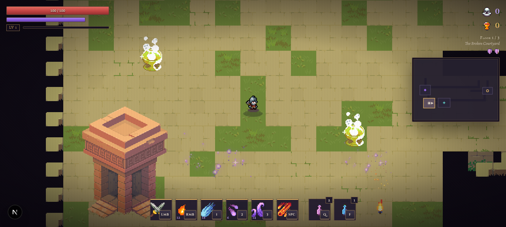
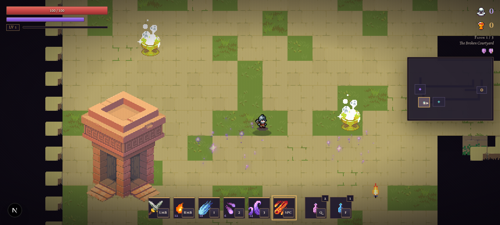
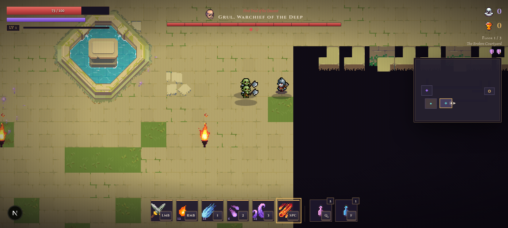

<p align="center">
  
</p>

<h3 align="center">A dark-fantasy pixel-art action roguelike that runs entirely in your browser.</h3>

<p align="center">
  <a href="#quick-start">Quick Start</a>&nbsp;&nbsp;·&nbsp;&nbsp;
  <a href="#features">Features</a>&nbsp;&nbsp;·&nbsp;&nbsp;
  <a href="#controls">Controls</a>&nbsp;&nbsp;·&nbsp;&nbsp;
  <a href="#the-descent-pact">Pacts</a>&nbsp;&nbsp;·&nbsp;&nbsp;
  <a href="#project-structure">Structure</a>&nbsp;&nbsp;·&nbsp;&nbsp;
  <a href="#documentation">Docs</a>
</p>

<p align="center">
  <a href="https://nextjs.org"></a>
  <a href="https://phaser.io"></a>
  <a href="#"></a>
  <a href="#"></a>
  <a href="#"></a>
  <a href="LICENSE"></a>
</p>

<p align="center">
  <a href="https://git.io/typing-svg"></a>
</p>

---

## The Descent

The seal beneath the ruined keep is weakening. Something is moving down there,
wearing the shapes of the fallen. You go down with a blade, a handful of spells,
and whatever the patrons of ember, frost and void are willing to trade you.

Every run is a freshly generated dungeon: rooms, corridors, champions, shrines,
a merchant who keeps his promises, and at the bottom, the Necromancer. Die and
the keep rearranges itself for the next fool. Earn soul shards either way.

<p align="center">
  
</p>
<p align="center"><sub><b>Floor 1 - The Broken Courtyard.</b> Grid-based collision, y-sorted sprites, procedural layout.</sub></p>

<p align="center">
  
</p>
<p align="center"><sub><b>Combat.</b> 3-hit melee combo, crits, dodge rolls with i-frames, status effects, knockback.</sub></p>

<p align="center">
  
</p>
<p align="center"><sub><b>Champion encounters.</b> Named minibosses guard the deeper floors with their own AI patterns.</sub></p>

## Features

| System | What you get |
|---|---|
| **Procedural dungeon** | Seeded room-and-corridor generation, distinct floor biomes, deterministic reruns of any seed |
| **Combat** | 3-hit melee combo with arc hitboxes, crits, hit-stop, knockback, dodge rolls with invulnerability frames |
| **Spellbook** | Fireball, Frost Nova, Arcane Bolt (multi-bolt upgrades), Whirlwind - each with mana cost and cooldown |
| **Boons** | Patron offerings from Ember, Frost and Void in three rarities, offered at boon shrines |
| **Relics & loot** | 15+ relics, gold, souls, potions, chests, and weighted drop tables |
| **Progression** | Level-ups with upgrade drafting, persistent meta shard rewards |
| **The Descent Pact** | Six stackable difficulty pacts (Hades-style) that raise the danger and the shard harvest |
| **Bosses** | Two floor Champions and a three-phase Necromancer with a dedicated fury phase |
| **HUD & minimap** | Live minimap with room discovery, hold-to-enlarge, boss bars, cooldown wheels |
| **Persistence** | Runs save to localStorage; continue where you fell |
| **Audio** | Fully synthesized Web Audio soundtrack and SFX - zero audio assets, zero loading |
| **Accessibility** | Reduced-FX mode, adjustable mix, keyboard remap-ready controls, ARIA-labelled UI |

## Quick Start

```bash
# install dependencies
bun install

# run the dev server on http://localhost:3000
bun run dev
```

The game lives at `/` - the only route. It needs a modern browser with WebGL.

```bash
# production build
bun run build
bun run start

# lint / typecheck
bun run lint
bunx tsc --noEmit
```

## Controls

| Input | Action |
|---|---|
| **W A S D** | Move |
| **Mouse** | Aim |
| **Left click** | Melee attack (3-hit combo) |
| **Right click** | Fireball |
| **Space** | Dodge roll (i-frames) |
| **1** | Frost Nova |
| **2** | Arcane Bolt |
| **3** | Whirlwind |
| **Q / F** | Health / mana potion |
| **E** | Interact - chests, shrines, portals, merchant |
| **Tab** (hold) | Enlarge the minimap |
| **I** | Inventory |
| **Esc** | Pause |

## The Descent Pact

Sworn before each run, stackable for a richer soul-shard harvest:

| Pact | Shard bonus | Effect |
|---|---|---|
| Hardened Foes | +15% | Enemies endure +35% more punishment |
| Relentless Foes | +15% | Enemies strike 25% harder |
| Quickened Horrors | +10% | Enemies move 15% faster |
| Frail Descent | +20% | You begin with 25% less health |
| Barren Halls | +20% | Gold and healing are halved |
| Boss Fury | +25% | The Necromancer enters a terrifying third phase |

## Project Structure

```
src/game/              Phaser core - scenes, entities, dungeon, combat, audio
  scenes/              BootScene (asset pipeline) + GameScene (the run)
  entities/            Player, enemies, champions, boss, pickups, props
  dungeon/             Seeded generator + tile renderer
src/components/game/   React UI overlays - menu, HUD, modals, end screens
src/lib/gameStore.ts   Zustand store bridging the game event bus to React
public/assets/         Processed sprites + machine-readable manifests
scripts/asset-tools/   Asset pipeline (rebuilds public/assets from packs)
docs/                  Design docs, QA reports, performance notes
```

## Architecture

The game renders on a **Phaser 3** WebGL canvas while every menu and HUD element
is a **React** overlay - the two sides never touch. A typed event bus carries
game state into a Zustand store, and commands flow back the same way:

```
Phaser scene  --(bus.emit)-->  Zustand mirror  --(selectors)-->  React overlays
React UI      --(bus.cmd)---->  GameScene command handler
```

The game layer boots behind a timeout watchdog and a boot-error surface, so an
engine failure degrades to a retry screen instead of an infinite loader.

## Asset Pipeline

`python3 scripts/asset-tools/build_assets.py` inspects the source sprite packs,
normalizes them into `public/assets/`, and emits manifests
(`effects.json`, `characters.json`, `icons.json`, `asset-manifest.json`) that
drive loading and per-frame animation durations at runtime. Re-run it after
changing the source packs. See [docs/ASSET_LICENSES.md](docs/ASSET_LICENSES.md)
for attribution.

## Documentation

| Doc | Contents |
|---|---|
| [Art direction](docs/ART_DIRECTION.md) | Palette, typography, UI language |
| [Asset licenses](docs/ASSET_LICENSES.md) | Attribution for every shipped sprite pack |
| [Asset manifest](docs/ASSET_MANIFEST.md) | How the pipeline output maps into the game |
| [Performance](docs/PERFORMANCE.md) | Optimization passes, budgets and profiling notes |
| [Quality report](docs/QUALITY_REPORT.md) | QA matrix and known-good scenarios |
| [Implementation status](docs/IMPLEMENTATION_STATUS.md) | Feature checklist |
| [Contributing](CONTRIBUTING.md) | Workflow, conventions, PR checklist |
| [Changelog](CHANGELOG.md) | Release history |

## License

Code is released under the [MIT License](LICENSE). Sprite assets are covered by
their own licenses - see [docs/ASSET_LICENSES.md](docs/ASSET_LICENSES.md)
before redistributing them.

<p align="center">
  <sub>The dead do not rest here. Neither should you.</sub>
</p>
